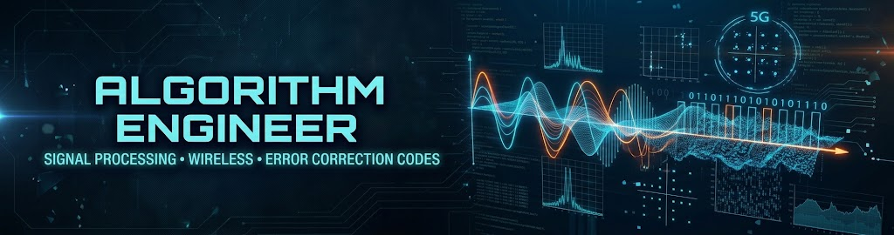
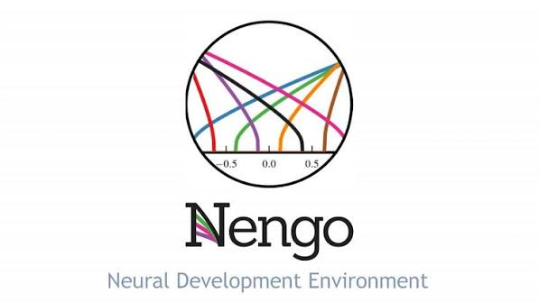
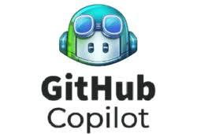

# Hi there, I'm Niv! 👋

## About Me 🚀

I'm a passionate **[Your Job Title / Developer Role]** with experience in **[technologies you're proficient in]**. I love tackling complex problems, learning new skills, and collaborating with diverse teams to create innovative solutions.
I'm a motivated varied **[Electrical Engineer]** who strives for finding the next adventure in **[Wireless Algorithms]** areas. Hard-worker, great team worker who looks for new innovative scopes to grow and inspire my surroundings.

- 🌱 Currently learning: **Error Correction Codes**
- 🔭 Working on        : **Convolution Codes**
- 🌍 Languages         : **Python**
- 📫 How to reach me   : **nivbhgame@gmail.com**
- ⚡ Fun fact          : **Like Math Videos and worked for 5.5 Years as Harware Verification Engineer**

### 🛠️ Languages & Tools

  
  
  
  
  
  
  
  
  
  
  

### 🔬 Domains & Research

*Replace the above skill badges with your own skills and expertise. To create more badges, use [checkout this repo](https://github.com/alexandresanlim/Badges4-README.md-Profile).*

## Featured Projects 💻

### [Convolutional Codes and Viterbi Decoding](https://github.com/nivb100/Convolution_Codes)

**[Convolutional Codes and Viterbi Decoding]** is a **[Error Correction Codes Project]** built with **[Python and Numpy]**. This project demonstrates my ability to **[Coding Theory, Python Coding and Theoretical Analysis]**.

